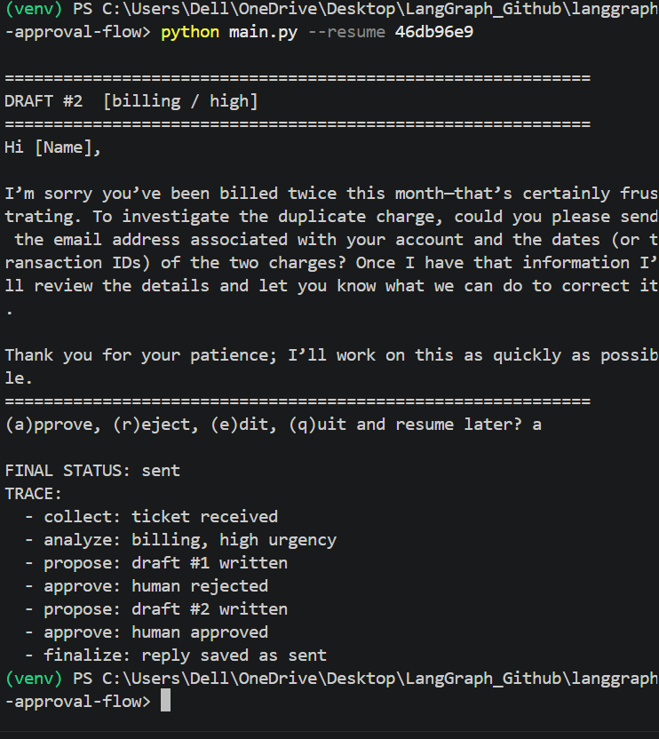

# langgraph-approval-flow

A support-ticket reply assistant built with LangGraph. An LLM classifies the ticket and drafts a reply, then the workflow **pauses for human approval** before anything is "sent". State is saved in SQLite, so a paused run can be resumed later.

**Skills shown:** LangGraph (state, nodes, conditional edges), human-in-the-loop with `interrupt()`, SQLite checkpointing, LLM calls inside a workflow.

## Workflow

    collect -> analyze -> propose -> [human approval] -> finalize
                            ^               |
                            +-- rejected ---+

| Node | What it does |
|---|---|
| collect | Receives the ticket |
| analyze | LLM labels category and urgency |
| propose | LLM writes a draft reply (uses reviewer feedback after a rejection) |
| approve | Pauses with `interrupt()` and waits for approve / reject / edit |
| finalize | Saves the reply as sent, or does nothing if not approved |

The code (not the LLM) controls step order, the pause, the retry limit (`MAX_REVISIONS = 3`) and what counts as "sent".

## Setup

    python -m venv venv
    venv\Scripts\Activate.ps1        # Mac/Linux: source venv/bin/activate
    pip install -r requirements.txt
    copy .env.example .env           # then add your Groq API key

## Run

    python main.py                          # default demo ticket
    python main.py "My app crashes on login"
    python main.py --resume 1a2b3c4d        # continue a paused run (use the printed thread id)

At the prompt: `a` approve, `r` reject (with feedback, then it redrafts), `e` edit, `q` quit and resume later.

## Demo

